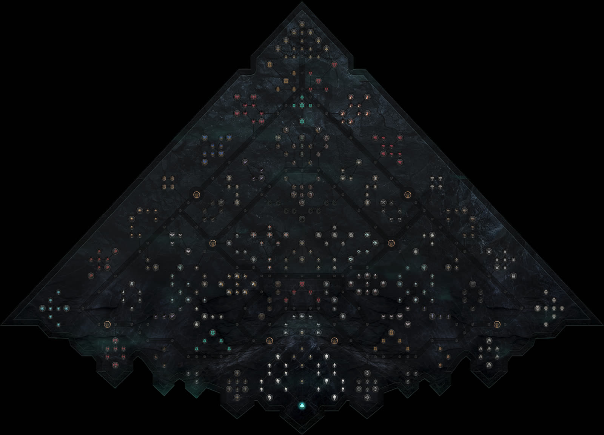

# Nagash Calc: Black Pyramid Planner

An interactive web planner for **The Black Pyramid of Nagash**, the research tree of the Undead Legions in *Total War: Warhammer III* (DLC *Nagash – Lords of the End Times*). It is modelled on [PoEPlanner](https://poeplanner.com/): you can

- plan which Sigils to empower,
- see the path cost and gateway requirements,
- read the combined effects,
- share the build as a link.



## Status

**Working MVP.** You can:

- search Sigils (by name, effect text, unit, cluster or section),
- click to empower a Sigil along the shortest path,
- click an empowered Sigil to refund it,
- read the combined bonuses grouped by section,
- see how many Sigils the plan needs, including gateway shortfalls,
- undo/redo, and share the build as a link.

The tree data comes straight from the game files. See the [roadmap](docs/roadmap.md).

```sh
npm install
npm run dev                           # http://localhost:5173
npm test                              # core logic tests
npm run build                         # static site in dist/
```

Regenerating the data after a game patch (needs a local WH3 install):

```sh
node tools/extract-game-files.mjs     # writes game_files/ (git-ignored)
node tools/build-tree.mjs 9.0.4       # writes public/data/black-pyramid.9.0.4.json + public/assets/
```

## Documentation

| Doc | Contents |
|---|---|
| [docs/game-mechanics.md](docs/game-mechanics.md) | How the Black Pyramid works: sigils, gateways, layout, known nodes, sigil sources, open questions |
| [docs/features.md](docs/features.md) | Feature spec, with priorities |
| [docs/data-model.md](docs/data-model.md) | Tree JSON schema, build/URL encoding, the pipeline for extracting game data |
| [docs/architecture.md](docs/architecture.md) | Proposed stack and code layout |
| [docs/roadmap.md](docs/roadmap.md) | Milestones |
| [docs/sources.md](docs/sources.md) | Every research source |
| [docs/reference/](docs/reference/) | Full-tree screenshot and icons |

## Disclaimer

This is an unofficial fan project, not affiliated with Creative Assembly, SEGA or Games Workshop. *Warhammer*, *Total War* and all related names and images are trademarks of their respective owners.
